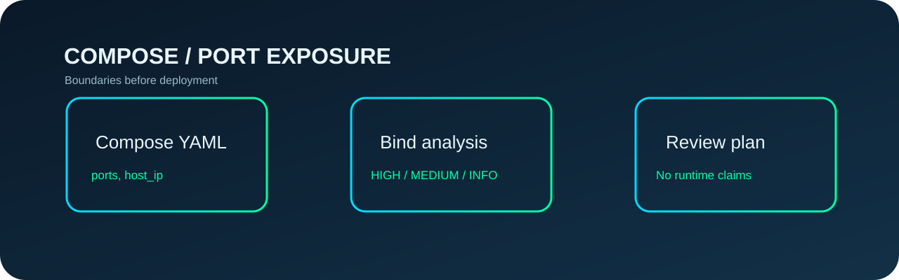

<p align="center"></p>

<p align="center"></p>

<h3 align="center">Know what the host actually publishes.</h3>
<p align="center">Read-only port exposure checks for Docker Compose — an independently testable open-source Agent Skill for Claude Code and Codex.</p>
<p align="center"><a href="https://github.com/Kanompung1988/compose-port-exposure-audit/actions/workflows/ci.yml"></a> <a href="https://agentskills.io/specification"></a> <a href="LICENSE"></a></p>

## The problem

Publishing ports without an explicit host bind exposes services to all host interfaces under normal Docker defaults. A database port written as `5432:5432` is easy to mistake for a container-only connection.

## What it delivers

- **Static, read-only report.** No Docker daemon, network calls, credentials, cluster connections or write-side effects.
- **Deterministic evidence.** Machine-readable JSON and human-readable text with meaningful severity labels.
- **Honest boundaries.** Unsupported syntax and runtime-dependent behavior are not silently advertised as safe.
- **Agent-compatible workflow.** A self-contained `SKILL.md`, explicit trigger/avoid rules, reusable examples, regression tests and two-version CI.

## 90-second quickstart

```bash
git clone https://github.com/Kanompung1988/compose-port-exposure-audit.git
cd compose-port-exposure-audit
python -m pip install -r requirements.txt
python scripts/audit.py compose.yaml --format text --fail-on high
```

### Reproducible synthetic example

```bash
python scripts/audit.py examples/safe.yaml --format json --fail-on high
python scripts/audit.py examples/review.yaml --format json --fail-on never
```

Expected evidence includes `"code": "DATA_PORT_PUBLIC_BIND"`; this is a fixture, **not** a finding against a real production project.

## Install with an AI coding agent

A Skill is a directory with the root `SKILL.md` file. Clone this repository to a project-local skills directory named **`compose-port-exposure-audit`**:

**Claude Code** (project local):

```bash
mkdir -p .claude/skills
git clone https://github.com/Kanompung1988/compose-port-exposure-audit.git .claude/skills/compose-port-exposure-audit
python -m pip install -r .claude/skills/compose-port-exposure-audit/requirements.txt
```

**Codex** (project local):

```bash
mkdir -p .agents/skills
git clone https://github.com/Kanompung1988/compose-port-exposure-audit.git .agents/skills/compose-port-exposure-audit
python -m pip install -r .agents/skills/compose-port-exposure-audit/requirements.txt
```

Then ask your agent to review a local Docker Compose config using this Skill. Your agent should use the procedure in `SKILL.md`, cite exact findings, and recommend a manual platform-native validation step.

## Project map

| Path | Purpose |
|---|---|
| `SKILL.md` | Cross-platform activation and procedure |
| `scripts/audit.py` | Deterministic static analyzer (CLI + importable logic) |
| `tests/test_audit.py` | Regression/security-boundary tests |
| `examples/` | Synthetic safe/review cases |
| `references/MODEL.md` | Source-backed semantics, assumptions and limitations |
| `.github/workflows/ci.yml` | Python 3.10/3.12 + fixture smoke and metadata checks |
| `assets/hero.svg` | Original editorial diagram |
| `assets/area-zero-logo-full.svg` | Unmodified official project logo; not MIT-licensed |

## Important limitations

This is a static Compose-file heuristic, not Docker runtime introspection. Daemon defaults, firewalls, host routes, container listeners, Compose interpolation, modes and per-host policies can change actual reachability. It does not parse multiple Compose overrides, network ranges or nonstandard mappings; it explicitly reports unresolved cases for review.

**For production:** run the platform-native check and review the real environment before relying on the result. Do not treat a heuristic scanner as an independent security audit.

## Reproduce and contribute

```bash
python -m unittest discover -s tests -v
python -m compileall -q scripts tests
```

See [CONTRIBUTING.md](CONTRIBUTING.md), [SECURITY.md](SECURITY.md) and [references/MODEL.md](references/MODEL.md). Code is MIT. Official Area Zero logo and brand identity are **excluded** from the MIT grant and remain with their respective rights holder; please replace them in unrelated forks.

## Authoritative references

- https://docs.docker.com/reference/compose-file/services/
- https://docs.docker.com/engine/network/port-publishing/
- https://docs.docker.com/compose/how-tos/networking/
